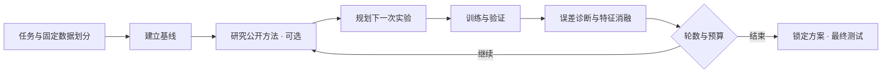

# AutoLab Agent

**面向表格建模的自主实验 Agent：提出假设、训练模型、分析误差，再用实验结果规划下一轮。**

项目将任务定义、模型适配和实验编排分离。当前支持分类与回归，以及 XGBoost、Random Forest、MLP、Logistic Regression / Ridge；等待时间预测仅作为领域示例保留。

仓库只包含源代码、人工配置和合成数据生成器，不包含公司数据、内部服务、历史实验成绩、训练权重、原始 Notebook 或运行记录。详细处理范围见 [SANITIZATION.md](SANITIZATION.md)。

## 实验闭环



- **自主规划**：LLM 根据验证结果、误差切片、置换重要性和公开资料，提出结构化实验；执行器验证模型、参数与特征范围。
- **多轮训练**：可配置轮数、每轮尝试次数、时间预算和连续无提升上限；比较模型、调整参数、做特征消融并更新最优方案。
- **实验血缘**：每个候选记录父实验、实验假设、配置变化和指标差值；界面可查看真实生成的实验关系图。
- **训练归因**：展示验证集置换重要性、分类错误切片或回归目标分位误差，以及父子实验对照；这些诊断不等同于因果解释。
- **自主联网研究**：LLM 可选择关键词、搜索来源、阅读网页或论文并记录工具轨迹；通用训练入口只允许公开资料检索与阅读工具。
- **可复现**：本地保存固定输入、划分、方案、代码哈希、依赖版本与预测；完成的实验可重训并校验预测一致性。

无 API 时可使用**内置策略**完成真实训练和诊断。它是确定性的模型对照、调参和消融策略，不是 LLM 推理。内置策略的可选联网功能按固定公开主题检索。

## 快速开始

使用 Python 3.12：

```bash
python3 -m venv .venv
source .venv/bin/activate
python -m pip install -r requirements.txt
bash run_webui.sh
```

打开 `http://127.0.0.1:5055`。默认使用合成数据与内置策略，无需 API Key。页面可配置任务、模型、轮数与预算，并查看实验记录、血缘图、归因和研究资料。

命令行运行：

```bash
python -m autolab.cli --task classification --rounds 3 --trials-per-round 2
python -m autolab.cli --config configs/autolab.regression.json
python -m autolab.replay artifacts/autolab/<run_id>
```

macOS 如遇 XGBoost 的 OpenMP 加载问题，先执行 `source scripts/_python.sh`，再使用 `"$AUTOLAB_PYTHON"` 运行以上模块。WebUI 启动脚本自动处理该路径。

## 配置自己的任务

将 CSV 放入被 Git 忽略的 `local_data/`，在页面选择“本地 CSV”，填写相对文件名和目标列。支持数值与类别输入，可选随机划分或按时间划分；时间列不作为输入特征，相同时间戳不会跨分区。文件限制为 50 MB、60–50,000 行、1–128 个输入字段。

配置示例见 [分类任务](configs/autolab.classification.json)、[回归任务](configs/autolab.regression.json) 与 [本地 CSV 模板](configs/autolab.local.example.json)。CSV 模板不附带任何数据。

分类指标为 accuracy / f1_macro，回归指标为 RMSE / MAE。训练、验证、测试比例约为 60/20/20；预处理仅拟合训练集，候选筛选只使用验证集，方案锁定后才评估最终测试集。轮数 × 每轮尝试次数是候选尝试上限，基线单独计算；无效或重复提案也消耗尝试预算。时间与停止请求在步骤边界检查，当前训练或网络请求可先完成。

## 启用 LLM 与联网研究

```bash
cp .env.example .env
chmod 600 .env
python scripts/configure_llm.py --help
```

在 `.env` 中填写自己的 API Key，在 `configs/llm.json` 中配置 endpoint、model 与 profile，然后在页面选择 LLM 规划器。仓库的 `api.example.com` 与模型名是无效占位符。支持 Chat Completions / Responses 兼容接口，实际能力取决于提供方。

通用规划器发送匿名特征 ID、聚合验证结果和公开资料片段，不发送原始数据行、字段名、目标值、文件路径或最终测试成绩。聚合指标仍会发送给所配置的服务；启用前应确认该服务适合处理你的实验信息。原始 CSV、字段映射、模型、日志及研究缓存仅保存在本地忽略目录中。

## 架构与扩展

| 模块 | 职责 |
| --- | --- |
| `autolab/tasks.py` | 任务契约、输入校验、数据划分与匿名特征映射 |
| `autolab/models.py` | 模型注册、有限搜索空间、预处理与指标 |
| `autolab/engine.py` | 规划、训练、诊断、最优方案与预算控制 |
| `autolab/replay.py` | 校验输入、代码与依赖，重训对比预测 |
| `webui/lab_api.py` | 独立训练进程、状态查询与停止 |
| `webui/static/autolab.*` | 通用训练工作台 |
| `skills/` | LLM 接口、资料检索、研究工具与领域示例能力 |
| `agent/` | 等待时间领域示例的特征工程与实验流程 |

扩展模型可在 `autolab/models.py` 注册 `ModelAdapter`，定义分类/回归构造器、默认参数和允许的搜索空间，并按需扩展 `build()` 的构造逻辑。模型需兼容 sklearn 的 `fit` / `predict` 接口。新增任务类型还需要相应的数据、指标和诊断适配，当前并不直接支持任意图像、文本或大模型训练。

## 等待时间领域示例

访问 `/examples/wait-time` 查看保留的领域工作台，包括特征 DSL、时间验证、多种子复验、概率融合、研究记忆和隔离代码工作区。

```bash
bash scripts/run_feature_mining.sh --mock --smoke --no-agent --model-family xgb
bash scripts/run_feature_mining.sh --mock --smoke --rounds 1 --max-proposals-per-round 2 --proposal-file tests/smoke_proposals.json
```

该示例只使用人工数据，生产数据库和解密实现已移除。其旧版普通特征搜索会复用测试窗口选择候选，相关成绩不能作为独立泛化结果；通用工作台采用上文的独立最终测试流程。

## 验证与运行边界

```bash
python -m unittest discover -s tests -p 'test_*.py'
node --test tests/*.js
```

本项目是默认监听本机的单用户研究工具。通用实验产物保存在 `artifacts/autolab/`；复现需要相同代码与依赖版本，使用冻结输入重训，不重新取数或调用 LLM。合成数据成绩仅证明流程可执行，不代表业务效果。

PDF 正文提取需要 Linux 与 Poppler；macOS 可保留文件并提示提取限制。领域示例的隔离代码执行需要 Linux 和相应沙箱，缺少隔离能力时拒绝执行。
